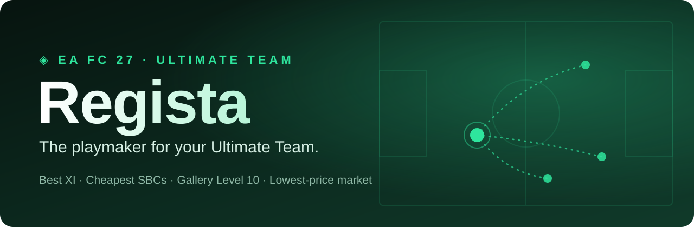

  

  

  <b>No daily limits · no ads · no account · runs on your own PC</b> 
  Works in the EA FC 27 Web App with Chrome or Edge on Windows 10 or 11. In English and German.

<b>English</b> · <a href="README.de.md">Deutsch</a>

---

A *regista* is the deep-lying playmaker who runs the game from midfield. Regista does the thinking for your club: the best XI you can field, the cheapest way through every SBC, the shortest road to Gallery Level 10, and buying and selling at the real lowest price. It sits inside the Web App you already use.

## What you get

| | |
|---|---|
| **Best XI** | Tries every formation with your own cards, counts chemistry exactly like EA, fits roles and tactics to your players. Proven best, not guessed. |
| **SBCs** | The cheapest squad that meets the requirements, counting what each card really costs you. Filled in as a draft; you submit. |
| **Gallery** | One button to your route to Level 10, with a grid of every set and its grade. Aim for Level 10, the most tokens per coin, or one set to a chosen grade. Cards are bought and relisted, so each one only costs the 5% tax. |
| **Gallery on every card** | EA's own player cards show **✓** if you've collected them, or **NEW** if your Gallery doesn't have them yet. |
| **Market** | Buy any card or list yours at the proven lowest live price, with one button on EA's own card view. |
| **Upgrades and hidden gems** | Market cards that clearly improve *your* team within your coins, and cards that play far above their rating. |

## Install (about 2 minutes)

**1. Click Download above.** You get `Regista-Setup.zip`. If your browser asks, choose **Keep**.

**2. Unzip it and run the setup.** Right-click the zip → **Extract All**, open the **Regista** folder and double-click **Setup Regista.cmd**. Windows may say *"Windows protected your PC"*, because the setup isn't from a big company. Click **More info** → **Run anyway**. It then does everything by itself: installs Python if you don't have it, copies Regista to your PC, sets up the engine and starts it whenever you sign in. Regista is already inside the zip, so the setup doesn't download and run anything else.

**3. One click in your browser.** Your extensions page opens with the folder already copied. Turn on **Developer mode**, click **Load unpacked**, press **Ctrl+V** and **Enter**. Browsers only let store extensions skip this step, and you only do it once.

**4. Open the [FC 27 Web App](https://www.ea.com/ea-sports-fc/ultimate-team/web-app/).** Regista appears inside EA's own screens: in every SBC, under Squads, Transfers, Club and Settings, and as a **Gallery** tab in the menu. **Alt+L** jumps to Regista on the current screen.

**Language:** Regista follows your Web App language. Change it under **Settings** → Regista → **Language**.

## Updates

When a new version is out, Regista shows **Update**. One click: it downloads the update, checks it carries the Regista release signature (anything else is refused), installs it without touching your settings, and reloads.

## Is it safe?

- **Your data stays on your PC.** The heavy maths runs in a small engine on your computer. Nothing about your club is sent anywhere.
- **You stay in control.** Nothing is bought, sold, listed or submitted without your click, and every purchase needs a second, confirming click.
- **Gentle on EA.** Market searches are spaced out and only run when you start them.
- **Honest risk.** Regista is an unofficial fan tool. Automating the Web App may be against EA's terms, so use it at your own risk.

## Questions

<b>Does it work on Mac or on my phone?</b>

No. Regista needs Windows 10 or 11 and Chrome or Edge on the same PC.

<b>Does something need to stay open?</b>

No. The engine starts hidden when you sign in to Windows. Just open the Web App.

<b>The panel says "solver off".</b>

Run **Setup Regista.cmd** again. It repairs the install and keeps your settings.

<b>How do I remove it?</b>

Run `Disable autostart.cmd` in `%LOCALAPPDATA%\Regista`, delete that folder, and remove Regista on your browser's extensions page.

---

Gallery sets, grades and prices come from [FUT.GG](https://www.fut.gg/fut-gallery/) via the open [gallery-grab](https://github.com/yusufcakcr/gallery-grab) build (PolyForm Noncommercial). Optimisation by Google [OR-Tools](https://developers.google.com/optimization). Regista is a free fan project, not affiliated with or endorsed by EA, FIFA or FUT.GG.
